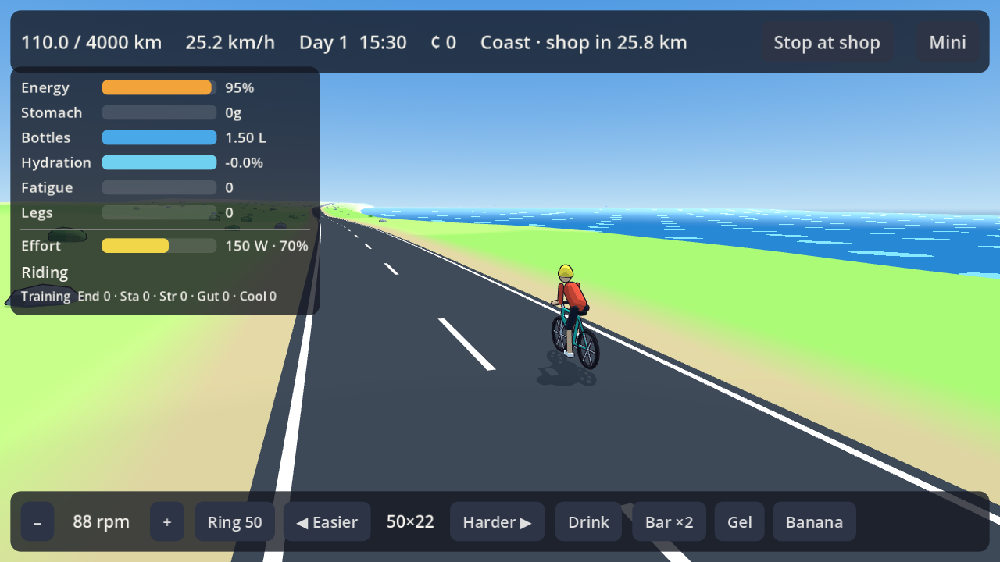

# Ultra Idle Cycling

An idle game about an ultra-distance cyclist. Keep it open in the corner of your screen and manage cadence, gears, carbs and water as the road rolls through cel-shaded landscapes.

Built with [Godot 4.7](https://godotengine.org/). See [docs/DESIGN.md](docs/DESIGN.md) for the design.



## Status

Playable prototype (step 2): a cel-shaded rider on an endless road through fields, hills, coast and mountains, with a day and night cycle, shops, upgrades, saving, offline progress and a small corner-window mode.

## Playing

Open the folder in Godot 4.7 and press **Play** (F5), or run `godot --path .` from this folder.

| Key | Action |
|---|---|
| A / D | Lower / raise cadence |
| Q / E | Easier / harder gear |
| F | Switch chainring |
| W | Drink |
| S | Eat the biggest snack |
| M | Toggle the small corner window |
| 1-4 | Debug builds only: time warp ×1, ×5, ×20, ×60 |
| F9 | Debug builds only: start a new ride |

Everything can also be done with the on-screen buttons. The game saves every 15 seconds and when you close it, to `user://save.json` (on a Mac: `~/Library/Application Support/Godot/app_userdata/Ultra Idle Cycling/`). Delete that file to start over.

## Running

Requires Godot 4.7 on your PATH as `godot`.

```sh
# Unit tests
godot --headless --path . --script res://tests/run_tests.gd

# Pacing simulation (2 real hours, all player types)
godot --headless --path . --script res://tools/simulate.gd

# One scenario, custom length
godot --headless --path . --script res://tools/simulate.gd -- minutes=30 scenario=checkin_5

# Fast playtest of the real game loop (catches runtime errors)
godot --headless --path . --script res://tools/playtest.gd

# Screenshots (needs a display; on Linux servers use xvfb-run)
godot --path . --script res://tools/screenshot.gd -- out=shots
```

All balance numbers are in `config/tuning.json`. Change them and rerun the simulation to see the effect.

## Layout

```
config/tuning.json   balance numbers, food, upgrades
sim/                 the simulation (no graphics)
game/                3D world, rider model, HUD, main game loop
shaders/             cel shading, outlines, water
tools/               pacing sim, playtest, screenshots
tests/               unit tests
```
